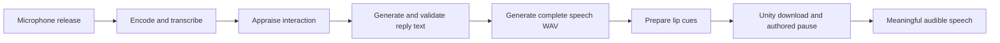

# RTX 4090: revised 15-second response plan

**Review date:** 29 October 2026. **Status:** proposed; target not yet qualified.
**Target:** the patient starts a meaningful spoken answer within **15 seconds of
microphone release**. The user confirmed this metric. The complete answer may
continue after 15 seconds. Earlier documents' 14-second target is historical.

**Recommendation:** first compare fully GPU-loaded **Gemma QAT Q4** with the
existing **BF16 cloned voices**, using the actual Unity game on the 4090. If speech
still exceeds its budget, develop a chunked speech backend and buffered Unity
playback. Preserve Q8 as the quality comparison and rollback option.

This review changes the plan, not running settings. Improvements 1–4 remain
enabled, the other choices remain optional, and the RTX 3080 stays the default.
The student-name prompt and named session export remain part of the Unity game.

## Context and evidence

The current saved [4090 profile](../services/config.rtx4090.json) selects Gemma Q8,
32 requested GPU layers, BF16 Higgs, multilingual CPU Whisper, beam 5, Rhubarb and
the approved per-voice delivery modes. Compact controls, reusable prompts, warmup
and exact speech reuse are already enabled. Forced sentence delivery, short-reply
limits, the alternative BF16 decoder, quantized speech and MTP are off.

| Evidence | What it supports | Limit |
| --- | --- | --- |
| 17 October real-model checks on RTX 3080: Q8/32 warm median 21.495 s; fully offloaded QAT Q4 3.486 s | Q4 with complete GPU offload is the strongest measured dialogue candidate | Four turns per condition; different replies; excludes STT, speech and Unity. It is not a 4090 speed prediction or an isolated precision comparison |
| Short, warmed BF16 clips on that 3080 took about 2.9–4.6 s for 2.9–4.9 s of audio | Speech can run close to real time in this implementation | Short clips without the target GPU and rendering load; longer emotional replies can behave differently |
| Attributed 4090 handoff: 50 replies, median preparation 24.894 s, median speech preparation 17.364 s; speech 71.19% of summed preparation | Investigate speech as well as dialogue | Raw paired records were absent from the handoff and not found in this review. Do not subtract medians to infer another stage's median |
| Beam 1 versus 5: 2.983 versus 3.066 s median on four clips | Small possible transcription gain | About 0.083 s in this sample; not the principal fix |
| Alternative BF16 decoder: small, variable gains | Optional tuning after larger bottlenecks | One voice was slightly slower; not a demonstrated route to the deadline |

Sources: [measured audit](RTX4090_LATENCY_AUDIT.md),
[underlying 3080 results](benchmarks/2026-10-17-latency-audit.json), and
[attributed 4090 handoff](BRANCH_INTEGRATION_2026_10_21.md).
The audit explicitly records no 4090 or audible end-to-end qualification.

The installed Q8 and QAT Q4 weight files are approximately 11.800 and 6.497 GiB
on disk. Their 5.303 GiB difference motivates the memory comparison; GPU allocation
also includes caches, speech, codecs, workspaces, rendering and driver overhead.
The current saved profiles select the pinned b11303/CUDA 12.4 runtime; older audit
results used their recorded runtime. Freeze and record the effective runtime for
each new comparison, rather than assuming old measurements transfer unchanged.

## Why the current path can miss 15 seconds

The critical path is:

All reply text currently finishes validation before synthesis begins. Most
approved voice/emotion recipes generate a complete emotional beat before returning
a WAV. Unity downloads that WAV before playing it. The existing sentence option
can publish smaller complete files while later files are generated; it does not
stream audio samples as they are produced. An 8–12-word first sentence reduces
the first speech job, but does not currently bypass full reply-text generation.

Exact recordings and generated-speech cache hits help repeated material. A newly
worded answer still requires synthesis and must qualify separately.

## Proposed work, in order

### 1. Measure the actual Unity deadline

Add a client monotonic timeline starting at microphone release, before encoding.
Record transcription request/response, turn submission, first segment received,
download/decode completion, authored pause and audio scheduling. Join server
appraisal, dialogue, queue, retry, speech and alignment timings using the turn ID.
Keep timing diagnostics free of student names, dialogue and recordings.

The existing `STREAM_FIRST_PLAYBACK_MS` is logged **before** WAV download and
`AudioSource.Play()`, and starts after the turn-start response. It excludes
transcription and cannot establish the requested deadline. `first_audio_ms`
also describes server readiness, not audible speech.

Validate audible onset with an audio-loopback run and annotate the first
intelligible answer. Scheduling audio is not proof it was heard; the current audio
check can accept up to three seconds of leading silence. Record later unexpected
gaps separately from intended emotional pauses.

### 2. Test QAT Q4 with complete GPU offload, keeping BF16 speech

Create a separate trial configuration from the saved 4090 profile. Change only:

| Setting | Current 4090 | First trial |
| --- | --- | --- |
| Dialogue model | Gemma Q8 | Gemma QAT Q4 |
| Model file | Q8 GGUF | Matching QAT Q4 GGUF |
| Requested GPU layers | 32 | 99; verify actual offload in startup logs |
| Voice precision and assignments | BF16, four assigned voices | Keep |
| Language and STT | Montenegrin; multilingual CPU Whisper, beam 5 | Keep |
| Lip sync and delivery | Rhubarb; approved per-voice modes | Keep |
| Context, prompt caching, warmup, speech reuse | Current settings | Keep |

Compare memory and latency with Unity rendering. Watch dedicated **and shared**
GPU memory, transient peaks, clocks and frame times. If memory is tight, test
smaller prefill batches separately; larger batches do not accelerate speech.
Complete Q8 GPU offload is a separate memory-fit experiment, not a presumed safe
setting for Q8 + BF16 + Unity on one 24 GB card.

Q4 changes dialogue precision. Compare patient facts, memory, emotional response,
boundaries and Montenegrin wording before selecting it for teaching.

Do not start by applying the old optimization-menu option 8: it bundles Q4,
sentence delivery, shorter replies, beam 1 and the decoder change, preventing a
clean first comparison and enabling options the user previously left optional.

### 3. If first speech remains slow, trial a shorter first speech job

Separately compare a short, meaningful first sentence and the existing sentence
delivery override while retaining BF16 and the original speaker references.
Preserve fuller answers when the student asks for detail. Review all four voices
and emotions because splitting an approved whole beat changes phrasing.

Measure actual gaps in Unity. Near-real-time synthesis can shift waiting between
sentences rather than remove it. A cached generic acknowledgement, breath or
filler phrase does not satisfy the response target. Do not truncate spoken words
or silently discard requested detail to pass the test.

### 4. If that still misses, implement chunked speech and Unity buffering

This is the main architectural change for reducing long speech waits:

- Qualify a chunk-capable speech runtime on the actual 4090. Use one active request
  and a measured memory budget that leaves room for dialogue and rendering.
- Decode each received audio chunk into PCM and queue it in a bounded Unity buffer.
  Preserve sample rate/channel metadata and measure underruns. Concatenating WAV
  container headers is not a PCM-streaming implementation.
- Choose an online lip-sync strategy. Blocking on whole-WAV Rhubarb alignment
  would retain the current first-audio bottleneck. Any simpler mouth animation
  remains an explicit quality trade-off.
- Adapt speech-activity validation to incremental delivery; a complete-waveform
  check cannot approve the entire reply before its first chunk is played.
- Preserve cancellation, stale-turn rejection and completed-speech history.
  Partial chunks must not commit unspoken words. Validate all voices, emotions,
  regional pronunciation and interruptions.

Boson's current [official model card](https://huggingface.co/bosonai/higgs-tts-3-4b)
documents SGLang-Omni chunk streaming and voice references. Its published latency
table uses an H100 and is not a prediction for this application. The
[consumer-GPU qualification roadmap](https://github.com/sgl-project/sglang-omni/issues/1120)
is still open at this review; it targets Linux and excludes Windows/WSL2 work.
Treat native-Windows/4090 suitability and compatibility with the pinned local
Transformers port as feasibility gates, not a ready-to-enable package update.
Pin a tested version; do not upgrade all model dependencies during the comparison.

### 5. Optimize the remaining slow stage

If appraisal plus dialogue still exceeds the budget, evaluate a combined,
schema-validated appraisal/reply call or a separately hosted small appraisal
model. Current dialogue depends on the appraised relationship state: removing
that pass without redesigning validation can change disclosure and boundary
behavior. Keep deterministic relationship/state checks and commit semantics.

If long text generation itself delays first speech, investigate validated
incremental text segments. Sending unvalidated partial JSON directly to speech is
not an acceptable shortcut.

If retaining Q8 and BF16 together is mandatory and the memory/latency trial fails,
evaluate a second speech GPU or PC before implementing per-turn weight swapping.
A second device can remove memory competition but still needs speech and transport
timing. A different speech model changes voice quality and needs a separate review.

## Budget and acceptance

These are **design allocations**, not measured guarantees:

| Stage | Target budget |
| --- | ---: |
| Encoding, transfer and transcription | 3 s |
| Appraisal and validated dialogue | 4 s |
| First speech preparation | 5 s |
| Lip cues and audio transport/decode | 1 s |
| Playback scheduling, intended onset pause and leading silence | 1 s |
| Margin | 1 s |
| Total | **15 s** |

Screen the current Q8 profile and the isolated Q4 trial on the actual 4090 first.
For qualification, collect at least 40 warmed, newly generated replies per
condition, ten per voice, including emotional and detailed questions. Include an
ongoing 20-turn conversation to expose history growth. Repeat matched conditions;
test desktop and Quest/VR separately with rendering active.

Report median, p95, maximum, misses, failures/retries, speech-generation duration,
audio duration, later gaps and GPU/frame behavior. Report cold startup, authored
openings, recordings and exact cache hits separately. Do not count them as novel
speech. A p95 under 15 seconds permits misses; a promise that every reply meets
15 seconds requires reporting every miss and the worst observed result. A finite
passing trial does not establish a universal hard deadline.

For an initial **preparation-only** screen, use the existing benchmark with
`--target-seconds 15` and the intended trial config. Its default remains the
historical 14 seconds. It uses isolated sessions and excludes actual Unity audio
output; it cannot replace the acceptance run. Verify the loaded LLM model/runtime,
not just an HTTP health response, before each configuration trial.

## Decision and next implementation

**First task:** add accurate Unity timing, then compare Q8/32 against fully
GPU-loaded QAT Q4 while keeping the BF16 voices and current language/quality
settings. **Next task if needed:** qualify and integrate chunked speech with
buffered Unity playback.

The BF16 decoder tweak, beam-1 transcription, MTP, quantized voices, allocator
flushes and larger batches are secondary experiments. None has evidence here of
independently delivering the target. The recent functional regression results
and Unity name/export check validate functionality, not 4090 response latency.
